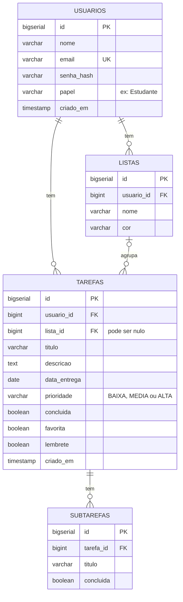

# Banco de dados

Banco **PostgreSQL 17**, com 4 tabelas. Elas são criadas pelo arquivo
`src/main/resources/db/migration/V1__criar_tabelas.sql`. Depois, o
`V3__perfil_do_usuario.sql` adiciona a coluna `papel` na tabela `usuarios` com `ALTER TABLE`
(é assim que se muda uma tabela que já tem dados).

## Diagrama (DER)

## Relacionamentos (cardinalidades)

| Relação | Tipo | O que acontece ao apagar |
|---|---|---|
| Usuário → Listas | 1 para N | Apagou o usuário, apaga as listas (`ON DELETE CASCADE`) |
| Usuário → Tarefas | 1 para N | Apagou o usuário, apaga as tarefas (`ON DELETE CASCADE`) |
| Lista → Tarefas | 0..1 para N | Apagou a lista, a tarefa **fica**, só sem lista (`ON DELETE SET NULL`) |
| Tarefa → Subtarefas | 1 para N | Apagou a tarefa, apaga as subtarefas (`ON DELETE CASCADE`) |

## Regras garantidas pelo próprio banco

- `email` é **UNIQUE**: não existem duas contas com o mesmo e-mail.
- `prioridade` tem um **CHECK**: só aceita `'BAIXA'`, `'MEDIA'` ou `'ALTA'`.
- Campos `NOT NULL` são obrigatórios (ex: toda tarefa precisa de título).
- **Índices** nas chaves estrangeiras deixam as buscas por usuário/lista mais rápidas.

## Dados de exemplo

O arquivo `V2__dados_exemplo.sql` cria a usuária **Maria** (`maria@email.com` / `123456`),
4 listas e 8 tarefas iguais às do design. As datas usam `CURRENT_DATE + N`, então as tarefas
"de hoje" sempre caem no dia em que o banco foi criado.

## Como olhar o banco

**Pelo navegador (Adminer):** http://localhost:8081

| Campo | Valor |
|---|---|
| Sistema | PostgreSQL |
| Servidor | db |
| Usuário | tarefinhas |
| Senha | tarefinhas |
| Base de dados | tarefinhas |

**Por um programa (DBeaver, pgAdmin...):** host `localhost`, porta **5544**, mesmo usuário/senha/base.
