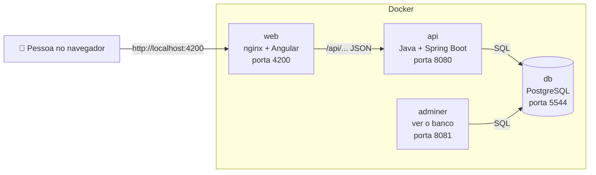

# Arquitetura (como as peças se conectam)

## Em palavras simples

1. A pessoa abre **http://localhost:4200**. Quem responde é o **nginx**, que entrega o site Angular.
2. O site precisa de dados (tarefas, listas...). Ele chama endereços que começam com **`/api`**.
3. O nginx repassa essas chamadas para a **API** (Spring Boot).
4. A API faz as **consultas SQL** no **PostgreSQL** e devolve a resposta em **JSON**.
5. O site recebe o JSON e desenha a tela.

## Os 4 containers (docker-compose.yml)

| Container | O que é | Porta no seu computador |
|---|---|---|
| `tarefinhas-web` | O site (Angular servido pelo nginx) | 4200 |
| `tarefinhas-api` | A API (Java 21 + Spring Boot) | 8080 |
| `tarefinhas-db` | O banco PostgreSQL 17 | 5544 |
| `tarefinhas-adminer` | Página para ver o banco | 8081 |

Os dados do banco ficam num **volume** do Docker chamado `dados-banco`. Por isso eles não somem
quando você desliga. O `resetar-dados.bat` apaga esse volume.

## Login simplificado

Para não complicar o trabalho, o login funciona assim:

1. O site manda e-mail e senha para `POST /api/auth/login`.
2. A API confere a senha com o **hash BCrypt** salvo no banco e devolve `{ id, nome, email }`.
3. O site guarda isso no navegador e, em toda chamada, manda o cabeçalho **`X-Usuario-Id`**.
4. A API usa esse id para mostrar só as coisas daquela pessoa (todo SQL tem `WHERE usuario_id = ...`).

> ⚠️ Num sistema de verdade usaríamos tokens (JWT) com Spring Security, porque qualquer um poderia
> mudar esse cabeçalho. Para um trabalho de faculdade, essa versão é mais fácil de entender e explicar.

## Tecnologias

| Parte | Tecnologia |
|---|---|
| Frontend | Angular 22, TypeScript, SCSS |
| Backend | Java 21, Spring Boot 4, Spring Data JPA, Flyway, Bean Validation, BCrypt, Swagger |
| Banco | PostgreSQL 17 |
| Infra | Docker + Docker Compose, nginx |
